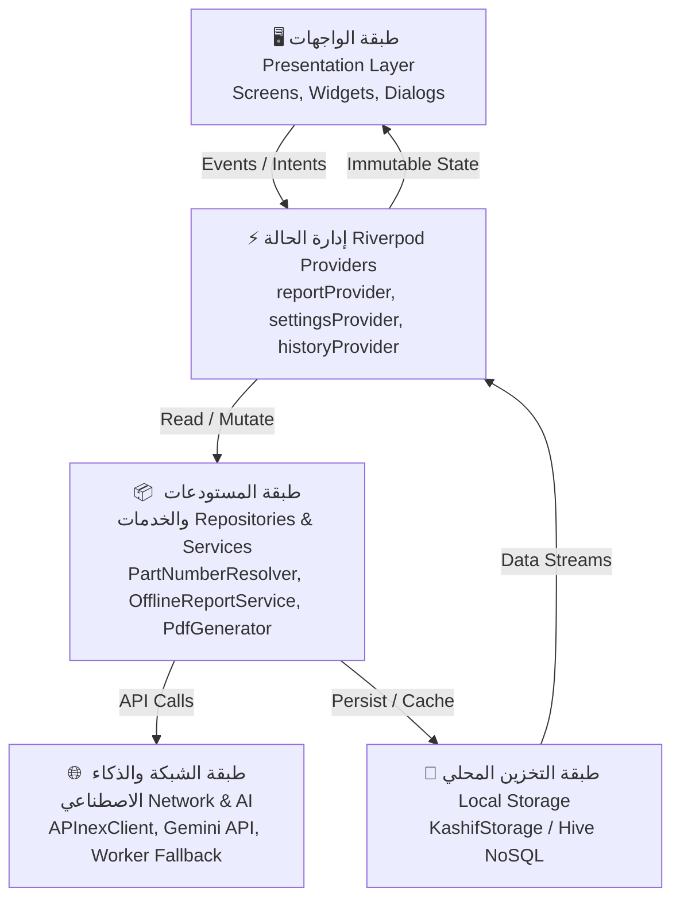
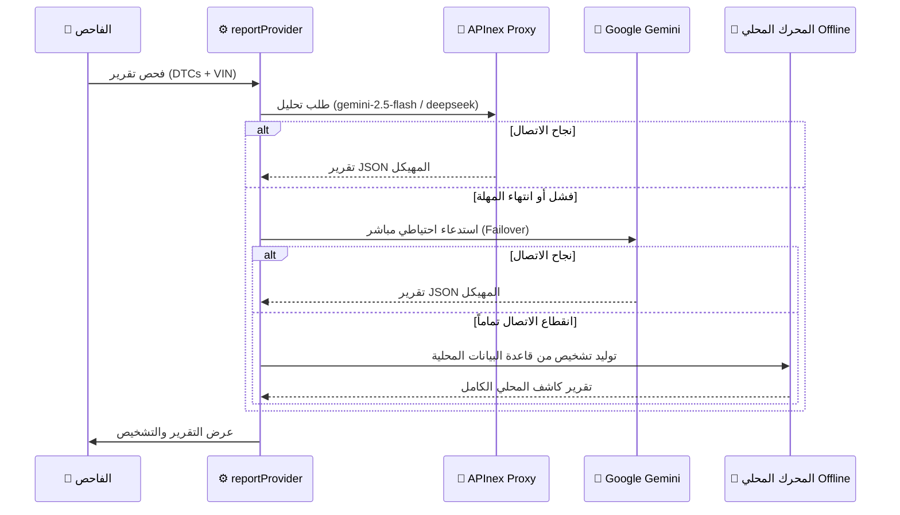

# 🏗️ المعمارية البرمجية والهندسة التقنية (Kashif Mobile Architecture)

يوثق هذا الدليل الهيكل البرمجي وأنماط التصميم وتدفق البيانات داخل تطبيق **كاشف موبايل (Kashif Mobile)**.

---

## 📐 نظرة عامة على التصميم (Architecture Overview)

يعتمد التطبيق نمط **Clean Architecture** الموجه بالطبقات، مع تدفق بيانات أحادي الاتجاه (**Unidirectional Data Flow**) وإدارة حالة تفاعلية عبر **Riverpod 2.6+**.



---

## 📂 هيكل المجلدات والطبقات (Folder Structure)

```text
kashif_mobile/
├── assets/
│   ├── data/
│   │   └── offline_dtc.json     # قاعدة المعرفة التشخيصية للأعطال بدون إنترنت
│   ├── fonts/                   # خطوط Readex Pro (Regular & Bold) و Amiri
│   └── images/                  # شعار التطبيق وأيقونات الأنظمة
├── lib/
│   ├── core/                    # الوحدات المركزية المشتركة
│   │   ├── constants/           # قواميس التوجيه (libyan_dictionary_prompt.dart)
│   │   ├── network/             # عملاء الشبكة (apinex_client.dart)
│   │   ├── theme/               # ألوان الفيوزات والخطوط والسمات (colors.dart, theme.dart)
│   │   └── utils/               # أدوات التوليد والتشغيل:
│   │       ├── ediag_pdf_parser.dart   # مفكك ملفات الفحص الرقمية بضغط ZLib
│   │       ├── html_generator.dart     # مولد تقارير HTML المستقلة
│   │       ├── pdf_generator.dart      # محرك تصدير PDF قياس A4
│   │       ├── report_qr_helper.dart   # تشفير الـ QR وضغط الحمولة
│   │       ├── report_sanitizer.dart   # حارس ومطهر اللهجة الليبية الصارم
│   │       └── share_service.dart      # خدمات المشاركة لنظام أندرويد
│   ├── data/                    # طبقة البيانات والنماذج
│   │   ├── models/              # كائنات البيانات غير القابلة للتغيير (Immutable Models)
│   │   │   ├── diagnostic_report.dart
│   │   │   ├── fault_code.dart
│   │   │   ├── spare_part.dart
│   │   │   ├── checklist_step.dart
│   │   │   └── vehicle_info.dart
│   │   ├── repositories/        # خدمات المعالجة والحوسبة
│   │   │   ├── part_number_resolver.dart    # الخوارزمية العامة لأرقام قطع الغيار
│   │   │   ├── offline_report_service.dart  # محرك التشخيص غير المتصل
│   │   │   └── sensor_locator_service.dart  # دليل مواقع الحساسات في المحرك
│   │   └── storage/
│   │       └── hive_storage.dart            # إدارة صناديق Hive والاسترداد الآمن
│   └── presentation/            # طبقة العرض والواجهات
│       ├── providers/           # مزودات Riverpod (StateNotifier)
│       ├── screens/             # الشاشات الرئيسية
│       └── widgets/             # العناصر التفاعلية وبطاقات الأعطال
```

---

## ⚡ إدارة الحالة (State Management with Riverpod)

يستخدم التطبيق مزودات `StateNotifierProvider` المعيارية لعزل منطق العمل عن واجهات العرض:

### 1. `reportProvider` (متحكم فحص التقرير الحالي)
- يدير حالة شاشة الفحص وعملية استخراج التقرير الحالية (`ReportState`).
- الحالات: `initial`, `loading`, `success`, `error`.
- يدير عملية الانتقال التلقائي للبدائل (**Automatic Failover**):
  ```
  APInex Proxy ──(Timeout / Quota)──> Direct Gemini API ──(Offline)──> OfflineReportService
  ```

### 2. `settingsProvider` (متحكم إعدادات المستخدم)
- يتحكم في السمة (Dark / Light / System).
- مفاتيح الـ API (Gemini Direct Key, APInex Key, Custom Endpoints).
- نمط توفير التوكنز الفائق (**Ultra Token Saver**): تفعيل أو تعطيل التوجيهات الإضافية لتقليل التكلفة وزمن الاستجابة.
- اسم الفاحص، اسم الورشة، ورقم هاتف الفني للتقارير المطبوعة.

### 3. `historyProvider` (سجل الفحوصات المحفوظة)
- يراقب صندوق الفحوصات في Hive ويوفر فرزاً تنازلياً حسب تاريخ الفحص.
- يدعم عمليات الإضافة، الحذف، والبحث السريع برقم الهيكل أو نوع السيارة.

---

## 💾 طبقة التخزين المحلي (Hive NoSQL & Safe Box Recovery)

تم تصميم `KashifStorage` ليكون مضاداً للأخطاء الصامتة والأعطال الناجمة عن ترقية الجداول:

```dart
// آليات الحماية داخل KashifStorage:
static Future<Box<T>> _safeOpenBox<T>(String boxName) async {
  try {
    return await Hive.openBox<T>(boxName);
  } catch (e) {
    // في حال حدوث تعارض في النمط (Type Cast mismatch) أو قفل غير مغلق:
    await Hive.deleteBoxFromDisk(boxName);
    return await Hive.openBox<T>(boxName);
  }
}
```

### الصناديق المستخدمة:
1. **`kashif_reports` (`Box<Map>`):** يخزن التقارير الكاملة مفهرسة بمعرف فريد (`reportId`). يتم تحويل الكائنات عبر دالة تحويل عميقة آمنة `_deepConvertMap` لمنع أخطاء `_Map<Object?, Object?> is not a subtype of Map<String, dynamic>`.
2. **`kashif_settings` (`Box`):** يخزن التفضيلات، الرموز، والخيارات الفنية.
3. **`kashif_parts_cache` (`Box<Map>`):** ذاكرة كاش مؤقتة وسريعة لنتائج أرقام قطع الغيار لمنع تكرار الحسابات الخوارزمية.

---

## 🌐 طبقة تكامل الذكاء الاصطناعي (AI & Fallback Pipeline)

يوفر التطبيق خط دفاع ثلاثي يضمن أن الفاحص في الورشة لا يتعطل أبداً:



---

## 📄 محرك تصدير وطباعة التقارير (PDF & HTML Architecture)

### 1. تقارير الـ PDF عبر `KashifPdfGenerator`
- مبني على معيار **A4** العالمي.
- يستخدم حزمة `printing` للتحويل عالي الدقة، مع تطبيق خطوط **Readex Pro** و **Amiri** الأصلية من مجلد الأصول.
- معالجة CSS `@media print` صارمة لضمان بقاء الجداول والبطاقات متراصة ومقروءة دون تقسيم عشوائي بين الصفحات (`page-break-inside: avoid`).

### 2. التقرير المستقل `Standalone HTML`
- ملف واحد ذاتي الاحتواء (`self-contained`) مدمج به الـ CSS والرموز بصيغة Base64.
- يعمل بدون أي خادم أو اتصال شبكي.
- يدعم الوضع الليلي الأصيل المتطابق مع هوية التطبيق.

---

## 🎨 هوية التصميم (The Fuse-Box Lid Design System)

مستوحاة من غطاء صندوق فيوزات السيارات الصناعي:
- **`KashifColors.darkBoard` (`#070E1E`):** لوحة القيادة الليلية العميقة.
- **`KashifColors.goldPrimary` (`#D4AF37`):** لون الذهب التقني للتنبيهات وعناصر التفاعل الرئيسية.
- **`KashifColors.fuse*`:** ألوان معيارية للأمبيرات (10A الأحمر، 15A الأزرق، 20A الأصفر، 30A الأخضر).
- **العناصر الهيكلية:** بطاقات `MoldedRib` تحاكي البلاستيك المقوى لصناديق الفيوزات مع حواف زجاجية مريحة للعين.
