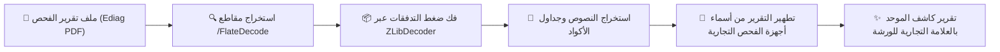

# 🇱🇾 محرك اللهجة الليبية والتشغيل غير المتصل (Libyan Terminology & Offline Engine)

يوثق هذا الدليل النظام المبتكر لتعريب المصطلحات الفنية إلى دارجة ورش الصيانة الليبية المعتمدة، إلى جانب معمارية التشغيل الذاتي الكامل دون اتصال بالإنترنت (**100% Offline Mode**).

---

## 🇱🇾 1. محرك المصطلحات الليبية المعتمدة (`ReportSanitizer`)

### الفلسفة والهدف:
لا يفهم أصحاب السيارات في ليبيا المصطلحات المترجمة ترجمة حرفية من الإنجليزية (مثل "ناقل الحركة الأوتوماتيكي" أو "شمعات الاحتراق" أو "صمام إعادة تدوير غاز العادم"). في المقابل، تختلف لهجة الورش الليبية عن اللهجات المجاورة.
تم بناء محرك `ReportSanitizer` لضمان أن كل تقرير يخرج من كاشف يتحدث لغة الورشة الليبية الحقيقية.

### الحماية المتقدمة بحدود اليونيكود (Regex Unicode Boundary Protection):
المشكلة الشائعة في التعريب النصي هي استبدال أجزاء من الكلمات (مثلاً: استبدال "قير" داخل كلمة "تقرير" ليتحول إلى "تقكمبيور"، أو داخل "استقرار" ليتحول إلى "استكمبيوار").
قام محرك كاشف بحل هذه المعضلة باستخدام تعابير نمطية تفحص الحروف العربية المحيطة:
```dart
// مثال على القواعد الصارمة داخل ReportSanitizer:
static final _gearPattern = RegExp(
  r'(?<![\u0621-\u064A])(?:قير|جير)(?![\u0621-\u064A])',
  caseSensitive: false,
);
```

### جدول المصطلحات الفنية الليبية المعتمدة:

| المصطلح الأجنبي / الفصيح | المصطلح المعتمد في كاشف | الاستخدام الفني في الورشة |
| :--- | :--- | :--- |
| Transmission / Gearbox | **كمبيو** | علبة التروس وناقل الحركة الأوتوماتيكي والعادي |
| Fuel Pump | **بومبة بنزين** | مضخة الوقود داخل خزان الوقود |
| Suspension System | **باطنيات / عضلات** | نظام التعليق السفلي وأذرع التوازن |
| Drive Shaft / Propeller | **سمياص / عمود سمياص** | عمود نقل الحركة والدوران |
| Control Arms / Wishbones | **براتشوات** | أذرع التحكم السفلية والعلوية للمساعدين |
| Shock Absorbers | **مزاطوريات / مزاطوري** | ممتصات الصدمات الأمامية والخلفية |
| Spark Plugs | **شمعات** | شمعات الاحتراق ومولدات الشرارة |
| Ignition Coils | **بوبينات** | ملفات وكويلات الإشعال |
| Camshaft | **إمبروكم** | عمود الكامات وحركة الصمامات |
| Valve | **فالب** | الصمام أو البلف (EGR فالب، PCV فالب) |
| Valve Cover Gasket | **قرسيوني كوبيركو** | جوان ووجه غطاء البلوف وحافظ الزيت |
| Thermostat | **تيرموستاتة** | منظم حرارة سائل التبريد في المحرك |
| Radiator Fan | **مروحة الرادياتوري** | مراوح تبريد سائل المحرك ومكيف الهواء |
| Alternator | **دينامو شحن** | مولد كهرباء البطارية |
| Starter Motor | **مارش** | بادئ تشغيل المحرك الكهربائي |

---

## 🛠️ 2. محرك الفحص غير المتصل (`OfflineReportService`)

### التصميم والاعتمادية:
في ورش الصيانة أو المناطق الصحراوية والطرق النائية، قد ينقطع الاتصال بالإنترنت تماماً. لذلك يحتوي تطبيق كاشف على **نواة تشخيصية محلية مدمجة** داخل التطبيق:

1. **قاعدة المعرفة المحلية (`assets/data/offline_dtc.json`):**
   - تضم تعريفات تفصيلية لأشهر أكواد الـ OBD-II المعيارية (محرك P، شاسيه C، هيكل B، شبكة اتصالات U).
   - توفر لكل كود:
     - اسم النظام بالعربية والإنجليزية.
     - الأعراض التي يشعر بها السائق.
     - الأسباب الجذرية المحتملة للعطل.
     - درجة الخطورة الفنية (Low, Medium, High, Critical).
     - الإجراء الموصى به للفني.
     - القطعة المطلوبة ورقمها التقديري.

2. **الاستدعاء الفوري والتلقائي:**
   - يتم تحميل قاعدة البيانات في الذاكرة عند بدء التشغيل عبر `OfflineReportService.load()`.
   - إذا فشلت شبكة الإنترنت أو نفدت حصة الـ API، ينتقل النظام ذاتياً لتوليد التقرير من القاعدة المحلية دون إشعار الزبون بأي فشل في النظام.

---

## 📄 3. مفكك تقارير الفحص الرقمية بضغط ZLib (`EdiagPdfParser`)

تدعم أجهزة الفحص الاحترافية (مثل Ediag و Launch و ThinkDiag) تصدير تقارير فحص بصيغة PDF. المشكلة أن هذه الملفات تحتوي على جداول ونصوص مضغوطة باستخدام خوارزميات **FlateDecode / ZLib**:

### آلية عمل `EdiagPdfParser`:


- **تطهير أسماء الماركات التجارية:** يقوم المحرك بإزالة شعارات وأسماء أجهزة الفحص (مثل Launch أو Ediag) ليكون التقرير النهائي الصادر للزبون باسم **ورشة الصيانة الخاصة بك** فقط وبشعار كاشف المعتمد.
- **استخراج بيانات المركبة آلياً:** قراءة رقم الهيكل (VIN)، الشركة الصانعة، الموديل، وسنة الصنع تلقائياً دون الحاجة لكتابتها يدوياً.
