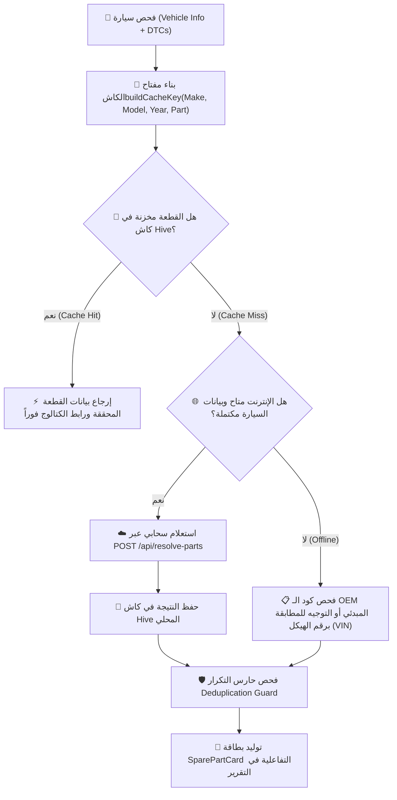

# ⚙️ محرك أرقام قطع الغيار الشامل (Universal Part Number Resolver)

يوثق هذا الدليل الهيكلية والخوارزمية الخاصة بحل واستخراج أرقام قطع الغيار الأصلية (**OEM Part Numbers**) والبدائل المعتمدة (**Aftermarket Replacements**) لجميع أنواع وموديلات السيارات داخل تطبيق **كاشف موبايل**.

---

## 🎯 المشكلة والحل الهندسي (The Core Challenge & Solution)

### المشكلة السابقة في تطبيقات الفحص التقليدية:
- الاعتماد على قوائم أرقام قطع غيار ثابتة ومكتوبة يدوياً (Hardcoded Lists) لعدد محدود جداً من السيارات، مما يولد أرقاماً وهمية أو غير مطابقة عند فحص سيارات خارج تلك القوائم.
- استخدام لاحقات اصطناعية مشوهة (مثل إضافة `-ALT` أو أرقام عشوائية).

### الحل في كاشف (`PartNumberResolver`):
نظام ذكي متكامل متعدد المراحل يجمع بين:
1. **التحليل السحابي المتصل (Cloud Grounding & AI)** لجلب أرقام القطع الحقيقية من كتالوجات الصانع.
2. **التخزين الدائم عالي السرعة (Persistent Hive Cache)** لحفظ القطع المستخرجة محلياً ومنع تكرار الاستعلامات.
3. **حارس التكرار (Deduplication Guard)** الذي يمنع تكرار نفس رقم الـ OEM لقطع مختلفة في نفس السيارة.
4. **روابط البحث اللحظية المباشرة (1-Tap Catalog Search URLs)** لتمكين الفني من مراجعة كتالوج الصانع بنقرة زر واحدة.
5. **التوجيه الصريح برقم الهيكل (VIN-Grounded Matching)** عند الحاجة لتحديد فئة المحرك بدقة.

---

## 🔄 مراحل تدفق البيانات (Resolution Pipeline)



---

## 🛠️ الخصائص والميزات البرمجية في `PartNumberResolver`

### 1. مفتاح الكاش المحكم (`buildCacheKey`)
يتم توليد مفتاح حتمي فريد لكل تركيبة من (صانع السيارة + الموديل + سنة الصنع + اسم القطعة الإنجليزي أو الليبي):
```dart
final cacheKey = 'part_${make}_${model}_${year}_${partName}';
```
هذا يضمن أن فحص سيارة تويوتا كامري 2018 لا يتداخل مع كامري 2023 أو مع سيارة هيونداي أخرى.

### 2. حارس التكرار الصارم (`Deduplication Guard`)
في حال قامت النماذج اللغوية بإرجاع نفس رقم القطعة لقطعتين مختلفتين (مثال: إعطاء نفس الكود لحساس الشكمان الأمامي والخلفي أو لبومبة البنزين والفلتر):
- يكتشف `enrichList` التكرار فوراً.
- يمنع عرض كود مكرر مضلل، ويستبدله بتوجيه صريح: **"مطابقة برقم الهيكل (VIN)"** مع توفير رابط البحث المباشر في الكتالوج.

### 3. روابط البحث المباشرة في الكتالوجات (`generateCatalogSearchUrl`)
يقوم النظام تلقائياً بإنشاء رابط بحث مشفر يجمع سنة الصنع، الشركة، الموديل، واسم القطعة ورقم الـ OEM، بحيث يفتح للفني مباشرة محرك البحث ومواقع الكتالوجات العالمية المتخصصة:
- سيارات تويوتا ولكزس: [Partsouq](https://partsouq.com) / [Amayama](https://www.amayama.com).
- سيارات بي إم دبليو: [RealOEM](https://www.realoem.com) / [BMWfans](https://bmwfans.info).
- سيارات فورد وشيفروليه وجيب: [RockAuto](https://www.rockauto.com).
- سيارات هيونداي وكيا ونيسان: [Catcar](https://www.catcar.info).

---

## 📱 بطاقة قطعة الغيار التفاعلية (`SparePartCard`)

في واجهة المستخدم (`lib/presentation/widgets/spare_part_card.dart`):

| العنصر في البطاقة | الوظيفة الفنية |
| :--- | :--- |
| **اسم القطعة باللهجة الليبية** | مثال: **"بومبة بنزين"**، **"شمعات احتراق"**، **"فالب الـ EGR"**. |
| **الاسم الإنجليزي القياسي** | يوضح المصطلح الفني المعتمد في كتالوجات الصيانة العالمية. |
| **رقم الـ OEM الأصلي** | يظهر في صندوق باركود مميز بخط مونوسبيس أحادي العرض (`Azeret Mono`). |
| **زر النسخ السريع 📋** | ينسخ رقم القطعة للحافظة بلمسة واحدة مع إشعار Toast سريع. |
| **زر البحث في الكتالوج 🌐** | يفتح المتصفح مباشرة بالبحث المخصص لهذه القطعة وتلك السيارة تحديداً. |
| **البدائل التجارية (Aftermarket)** | يعرض الشركات البديلة المعتمدة (مثل Bosch, Denso, NGK, Delphi, Valeo). |
| **السعر التقديري بالدينار الليبي** | شريط تسعير يوضح الحد الأدنى والأعلى المتوقع في السوق المحلي الليبي. |

---

## 🧪 التحقق والاختبارات الآلية (Automated Verification)

تخضع خوارزمية `PartNumberResolver` لمجموعة اختبارات صارمة في `test/`:
- **منع الأكواد الوهمية:** التأكد من عدم وجود أي كود يحمل `-ALT` أو أرقاماً عشوائية غير موثقة.
- **سلامة الكاش:** اختبار التخزين والاسترجاع السريع من `Hive`.
- **حارس التكرار:** التأكد من تفكيك أي تكرار وتوجيهه للمطابقة برقم الهيكل.
