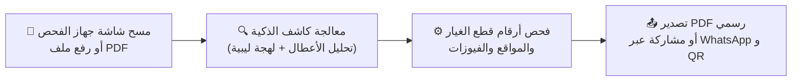

# 🔧 دليل الأسطى وفني الورشة السريع (Workshop Quick Start Guide)

هذا الدليل مخصص لفنيي التشخيص، أصحاب ورش صيانة السيارات، والمهندسين الميدانيين في ليبيا لاستخدام تطبيق **كاشف (Kashif Mobile)** في الفحص اليومي للسيارات وتوليد تقارير رسمية للزبائن.

---

## ⚡ الخطوات الأساسية في 4 دقائق

---

## 1. 📥 تثبيت التطبيق والتشغيل لأول مرة
1. انقل ملف الـ APK المترجم من الحاسوب إلى هاتفك (عبر كابل USB أو تطبيق تلغرام/واتساب):
   - ملف الإصدار الجاهز: `APK_OUTPUT\kashif_poco_x7_pro.apk`.
2. اضغط على الملف واختر **تثبيت (Install)**.
   - إذا ظهر تنبيه من نظام الحماية (HyperOS / MIUI)، اختر **السماح بالتثبيت من هذا المصدر**.
3. افتح التطبيق؛ ستظهر شاشة الإقلاع الملكية بشعار كاشف فوراً ثم شاشة "فحص جديد".

---

## 2. 📸 خيارات إدخال الفحص

يمنحك تطبيق كاشف 4 طرق مرنة للتعامل مع أي فحص:

| طريقة الفحص | كيف تستخدمها؟ | الأجهزة المدعومة |
| :--- | :--- | :--- |
| **تصوير شاشة الجهاز (Camera OCR)** | اضغط زر الكاميرا ووجه الهاتف مباشرة نحو شاشة جهاز الفحص، وتأكد من وضوح كود العطل (مثل `P0300`, `P0171`). | Launch X431, Autel MaxiSys, ThinkDiag, Topdon, Ediag. |
| **استيراد ملف PDF الرقمي** | اضغط على **استيراد تقرير PDF** واختر ملف التقرير المستخرج من جهاز الفحص. | تقارير Ediag و Launch الرسمية الرقمية. |
| **الإدخال اليدوي** | اضغط على **إدخال يدوي للأكواد** واكتب أكواد الـ DTC مفصولة بمسافة (مثال: `P0300 P0171 P0420`) مع رقم الهيكل (VIN). | أي فحص سريع أو دون وجود ورقة فحص. |
| **الفحص السريع بكود منفرد (DTC Lookup)** | انتقل إلى تبويب **الأعطال** في الشريط السفلي واكتب أي كود عطل تريده ليعطيك تشخيصاً كاملاً للقطعة وعطلها فوراً. | فحص فوري وسريع لأي كود مفرد. |

---

## 3. 🧠 قراءة التقرير وفهم نتائج التشخيص

بعد الضغط على **بدء الفحص والتشخيص**:
1. **نسبة السلامة العامة (Health Score):** يظهر مؤشر دائري يوضح الحالة الفنية للسيارة ونسبة خطورة الأعطال المسجلة.
2. **شرح الأعطال باللهجة الليبية الدارجة:**
   - يترجم التطبيق الأعطال التقنية المعقدة إلى مصطلحات الصيانة اليومية في ورش ليبيا (مثال: **"كمبيو"** بدلاً من ناقل الحركة، **"بومبة البنزين"** بدلاً من مضخة الوقود، **"شمعات وبوبينات"** بدلاً من بواجي وكويلات).
3. **أسباب العطل وأعراضه على السائق:** قائمة واضحة ومباشرة تشرح للزبون ما الذي يشعر به أثناء قيادة السيارة جراء هذا العطل.

---

## 4. 🔩 بطاقات قطع الغيار الذكية وأرقام الـ OEM العالمية

في قسم **قطع الغيار المطلوبة (Spare Parts)**، يقدم كاشف نظاماً متطوراً لكل قطعة مطلوبة:

- **رقم القطعة الأصلي (OEM Part Number):**
  - لا يعتمد التطبيق على أرقام ثابتة وهمية، بل يستخدم محرك `PartNumberResolver` لتوليد رقم القطعة القياسي المتوافق مع كتالوج الوكالة ونظام الشركة المصنعة (تويوتا، هيونداي، فورد، بي إم دبليو، إلخ).
- **زر النسخ السريع (Copy Button):** لنسخ رقم القطعة وإرساله فوراً لمحلات قطع الغيار أو جروبات الواتساب.
- **البحث المباشر في الكتالوجات العالمية:**
  - اضغط على زر **البحث في الكتالوج** ليفتح لك الكتالوج المتخصص مباشرة برقم القطعة (مثل Partsouq للسيارات اليابانية، RockAuto للأمريكي، RealOEM لـ BMW).
- **السعر التقديري بالدينار الليبي (LYD):** يساعد الزبون في تقدير ميزانية الصيانة المطلوبة قبل شراء القطع.

---

## 5. 🔌 مكتشف الفيوزات ودليل لمبات الطبلون

- **دليل ومكتشف الفيوزات (Fuse Box Screen):**
  - متوفر في الشريط السفلي؛ يتيح لك البحث عن فيوز أي نظام كهربائي (مثل فيوز طرمبة البنزين Fuel Pump، فيوز البوبينات، فيوز مراوح التبريد) ومعرفة موقعه (صندوق المحرك أو أسفل المقود) ورقمه وقوة الأمبير المناسبة.
- **دليل لمبات التحذير (Dashboard Lights):**
  - يوضح معاني الإشارات التحذيرية في الطبلون، درجة خطورتها، والإجراء الفوري المطلوب اتخاذه.

---

## 6. 📤 تصدير ومشاركة التقرير مع صاحب السيارة

لتقديم خدمة احترافية ترفع من موثوقية ورشتك أمام الزبائن:

### أ) طباعة وتصدير تقرير PDF رسمي (A4)
- اضغط على **تصدير تقرير PDF**.
- يقوم كاشف ببناء تقرير ورقي فاخر بخط Readex Pro العربي الصريح، يتضمن:
  - اسم ورشتك واسم الفاحص وتاريخ وساعة الفحص.
  - جدول الأعطال التفصيلي مع أرقام قطع الغيار وخطوات الفحص.
  - باركود الفحص وختم الورشة الإلكتروني.
  - إمكانية الطباعة المباشرة على طابعات الورشة اللاسلكية أو حفظ الملف بصيغة PDF.

### ب) تقرير الويب المستقل (Standalone HTML)
- احفظ التقرير كملف HTML مستقل؛ يفتح على هاتف الزبون في أي متصفح بالوضع الليلي الكامل دون الحاجة إلى تثبيت أي برامج.

### ج) المشاركة السريعة عبر WhatsApp & QR Code
- اضغط زر **رمز الاستجابة السريع (QR)** في أعلى شاشة التقرير.
- يمكنك جعل الزبون يمسح الـ QR بهاتفه مباشرة، أو الضغط على **إرسال عبر WhatsApp** لإرسال رسالة منسقة وجاهزة تتضمن ملخص الفحص ورقم الشاسيه مباشرة إلى رقم هاتف الزبون.

---

## 💡 نصائح ذهبية لنتائج فحص دقيقة
1. **أدخل رقم الهيكل (VIN) كلما أمكن:** يساعد التطبيق على ضبط أرقام قطع الغيار المناسبة لموديل وسنة صنع السيارة بدقة متناهية.
2. **استخدم بوابة APInex المجانية للسرعة:** في شاشة الإعدادات، ضع مفتاح APInex المجاني الخاص بك واختر نموذج `gemini-2.5-flash` للحصول على تقارير تفصيلية في ثوانٍ معدودة.
3. **يعمل التطبيق دون إنترنت بالكامل:** إذا انقطع الإنترنت في الورشة، سيعتمد كاشف تلقائياً على قاعدة بياناته المحلية (`Offline Report Service`) دون أن يتوقف عن العمل.
